# Analisis eksperimen local search

Total **54 run**. Semua state awal/akhir, objective, seluruh sel truk, riwayat, durasi dan file grafik diperiksa saat menyusun laporan ini.

## Protokol dan batas interpretasi

Seed: 11, 22, 33. Konfigurasi lengkap, hash input/source, versi Python/Matplotlib, dan lingkungan tersimpan pada [manifest.json](manifest.json). Eksekusi berurutan dalam satu proses; durasi meliputi inisialisasi dan pemeriksaan local optimum SA, mengecualikan IO dan plot.

Kasus utama memakai single_value: empat varian HC dan SA masing-masing 3 run, GA 18 run (2 kelompok × 3 variasi × 3 seed). Bonus multi_value menjalankan keenam algoritma masing-masing 3 run dengan parameter kontrol; single_eta memeriksa objective alternatif pada 3 run steepest ascent.

Upper bound adalah jumlah kontribusi semua paket, mengabaikan constraint. Mencapainya dengan state valid membuktikan optimum global untuk dataset itu. Jika belum tercapai, persentase terhadap upper bound bukan bukti gap terhadap optimum sebenarnya. Optimum eksak untuk kasus kecil dibuktikan terpisah oleh oracle enumerasi independen pada tes penerimaan.

## Perbandingan pada konfigurasi kontrol

GA di tabel ini hanya memakai 3 seed pada populasi dan generasi kontrol, agar hasil 18 konfigurasi tidak dicampurkan dengan konfigurasi tunggal algoritma lain.

| Algoritma | n | Rerata objective | SD | Min–maks | Rerata detik | Rerata iterasi | % upper bound |
| --- | ---: | ---: | ---: | --- | ---: | ---: | ---: |
| ga | 3 | 1161.667 | 26.247 | 1125–1185 | 2.0620 | 50.00 | 93.31 |
| random_restart | 3 | 1245.000 | 0.000 | 1245–1245 | 30.0686 | 17.00 | 100.00 |
| sa | 3 | 1075.000 | 131.593 | 890–1185 | 1.4782 | 1000.00 | 86.35 |
| sideways | 3 | 1195.000 | 70.711 | 1095–1245 | 47.5103 | 22.00 | 95.98 |
| steepest_ascent | 3 | 1195.000 | 70.711 | 1095–1245 | 6.0079 | 3.00 | 95.98 |
| stochastic | 3 | 1168.333 | 108.423 | 1015–1245 | 0.5405 | 1000.00 | 93.84 |

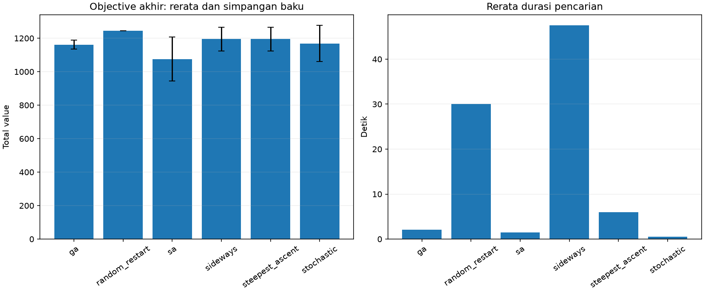

Objective terbaik pada konfigurasi kontrol adalah **1245** (random_restart, seed 11); upper bound **1245**. Rerata waktu terendah pada pengukuran ini: **stochastic**. Simpangan baku di tabel mengukur konsistensi tiga seed; hasil ini belum cukup untuk menggeneralisasi urutan kinerja ke dataset lain.

Steepest ascent hanya menerima peningkatan langsung sehingga dapat berhenti pada plateau yang membutuhkan rotasi netral. Sideways menelusuri plateau sampai batas totalnya; random restart mencoba inisialisasi baru. Stochastic menghemat evaluasi tetangga melalui sampling. SA dapat menerima penurunan dan bergerak pada plateau; hasil akhirnya adalah state pada akhir pendinginan, bukan selalu best-so-far (keduanya tersedia di CSV). GA mempertahankan satu elite, melakukan roulette selection, one-point crossover, repair validitas, dan mutasi neighbor.

## Pengaruh parameter GA

| Kelompok | Populasi | Generasi | n | Rerata objective | SD | Rerata detik |
| --- | ---: | ---: | ---: | ---: | ---: | ---: |
| A | 20 | 25 | 3 | 1136.667 | 10.274 | 2.6506 |
| A | 20 | 50 | 3 | 1161.667 | 26.247 | 2.0620 |
| A | 20 | 100 | 3 | 1191.667 | 4.714 | 2.8509 |
| B | 10 | 50 | 3 | 1178.333 | 49.889 | 0.9352 |
| B | 20 | 50 | 3 | 1161.667 | 26.247 | 2.4344 |
| B | 40 | 50 | 3 | 1145.000 | 22.730 | 4.3242 |

Kelompok A mengontrol populasi dan mengubah generasi; kelompok B mengontrol generasi dan mengubah populasi. Dengan seed yang sama dan elitisme, memperpanjang generasi mempertahankan atau meningkatkan best-so-far. Populasi lebih besar mengubah sampling awal dan dinamika seleksi sehingga objective tidak harus monoton terhadap ukuran populasi. Tabel memperlihatkan trade-off kualitas/waktu yang benar-benar terukur, bukan jaminan bahwa parameter terbesar selalu terbaik.

## Metrik khusus dan bonus

| Kasus | Algoritma | Seed | Objective | Iterasi | Sideways total | Restart | Iterasi tiap run restart | Episode local optimum |
| --- | --- | ---: | ---: | ---: | ---: | ---: | --- | ---: |
| multi_value | random_restart | 11 | 1285 | 22 | 0 | 3 | [4, 5, 4, 9] | 0 |
| multi_value | random_restart | 22 | 1285 | 24 | 0 | 3 | [6, 5, 8, 5] | 0 |
| multi_value | random_restart | 33 | 1285 | 26 | 0 | 3 | [9, 8, 4, 5] | 0 |
| multi_value | sideways | 11 | 1285 | 23 | 20 | 0 | [] | 0 |
| multi_value | sideways | 22 | 1285 | 25 | 20 | 0 | [] | 0 |
| multi_value | sideways | 33 | 1285 | 28 | 20 | 0 | [] | 0 |
| multi_value | steepest_ascent | 11 | 1285 | 4 | 0 | 0 | [] | 0 |
| multi_value | steepest_ascent | 22 | 1285 | 6 | 0 | 0 | [] | 0 |
| multi_value | steepest_ascent | 33 | 1285 | 9 | 0 | 0 | [] | 0 |
| multi_value | stochastic | 11 | 1285 | 1000 | 0 | 0 | [] | 0 |
| multi_value | stochastic | 22 | 1165 | 1000 | 0 | 0 | [] | 0 |
| multi_value | stochastic | 33 | 1245 | 1000 | 0 | 0 | [] | 0 |
| multi_value | sa | 11 | 1130 | 1000 | 0 | 0 | [] | 0 |
| multi_value | sa | 22 | 1100 | 1000 | 0 | 0 | [] | 0 |
| multi_value | sa | 33 | 1110 | 1000 | 0 | 0 | [] | 0 |
| single_eta | steepest_ascent | 11 | 332.667 | 3 | 0 | 0 | [] | 0 |
| single_eta | steepest_ascent | 22 | 362.667 | 3 | 0 | 0 | [] | 0 |
| single_eta | steepest_ascent | 33 | 362.667 | 3 | 0 | 0 | [] | 0 |
| single_value | random_restart | 11 | 1245 | 14 | 0 | 3 | [3, 2, 4, 5] | 0 |
| single_value | random_restart | 22 | 1245 | 17 | 0 | 3 | [3, 5, 6, 3] | 0 |
| single_value | random_restart | 33 | 1245 | 20 | 0 | 3 | [3, 5, 4, 8] | 0 |
| single_value | sideways | 11 | 1095 | 22 | 20 | 0 | [] | 0 |
| single_value | sideways | 22 | 1245 | 22 | 20 | 0 | [] | 0 |
| single_value | sideways | 33 | 1245 | 22 | 20 | 0 | [] | 0 |
| single_value | steepest_ascent | 11 | 1095 | 3 | 0 | 0 | [] | 0 |
| single_value | steepest_ascent | 22 | 1245 | 3 | 0 | 0 | [] | 0 |
| single_value | steepest_ascent | 33 | 1245 | 3 | 0 | 0 | [] | 0 |
| single_value | stochastic | 11 | 1015 | 1000 | 0 | 0 | [] | 0 |
| single_value | stochastic | 22 | 1245 | 1000 | 0 | 0 | [] | 0 |
| single_value | stochastic | 33 | 1245 | 1000 | 0 | 0 | [] | 0 |
| single_value | sa | 11 | 890 | 1000 | 0 | 0 | [] | 0 |
| single_value | sa | 22 | 1150 | 1000 | 0 | 0 | [] | 0 |
| single_value | sa | 33 | 1185 | 1000 | 0 | 0 | [] | 0 |

Frekuensi stuck SA menghitung episode memasuki state tanpa neighbor legal yang strictly improving, termasuk state awal bila sudah demikian. Plateau dan optimum global juga termasuk weak local optimum; episode baru dihitung setelah keluar lalu masuk lagi. Pemeriksaan eksak mempertimbangkan insertion dan swap yang dapat menambah score, dengan orientasi saat ini. Rotasi/perpindahan di dalam truk tidak langsung mengubah dua objective aditif. Definisi ini bukan proxy sejumlah langkah tanpa best-so-far baru.

Plot SA menampilkan e^(Delta E/T) pada koordinat logaritmik, termasuk nilai >1. Acceptance probability terpisah dibatasi pada 1. Jika raw exp overflow, JSON menyimpan null, flag overflow dan log ekspresinya; nilai tidak dipalsukan menjadi 1.

## Heuristik dan reproduksi

Initial state mengacak urutan paket, orientasi dan koordinat kandidat, serta boleh meninggalkan paket di luar. Neighborhood eksak memakai seluruh koordinat integer interior dan slot parkir luar yang aman; slot luar membatasi ruang pencarian tanpa mengubah objective. Sampling langsung mencoba paling banyak 100 gerakan; kegagalan sampling tidak membuktikan tidak adanya neighbor (stop reason stochastic menyatakannya). Repair GA memasukkan gen dari bawah ke atas dan memarkir gen yang melanggar constraint.

Rincian per-run, termasuk populasi, state JSON, plot, raw value dan durasi: [summary.csv](summary.csv). Buka JSON dengan `python -m src.visualization <file>`. Gambar berikut adalah run terbaik per algoritma/kasus; semua run lainnya tetap dapat divisualisasikan dari JSON.

### multi_value / ga

Seed 33, objective 1225; 95.33% upper bound; optimum belum dibuktikan.

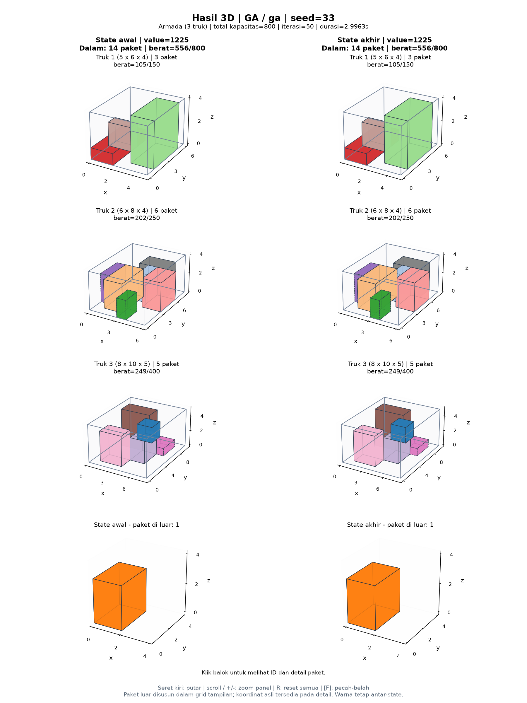

### multi_value / random_restart

Seed 11, objective 1285; upper bound tercapai: optimum global terbukti.

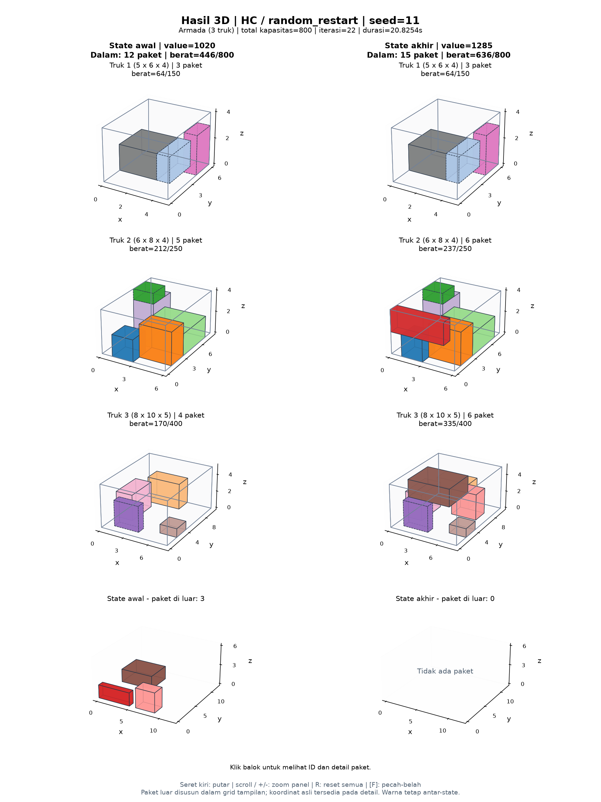

### multi_value / sa

Seed 11, objective 1130; 87.94% upper bound; optimum belum dibuktikan.

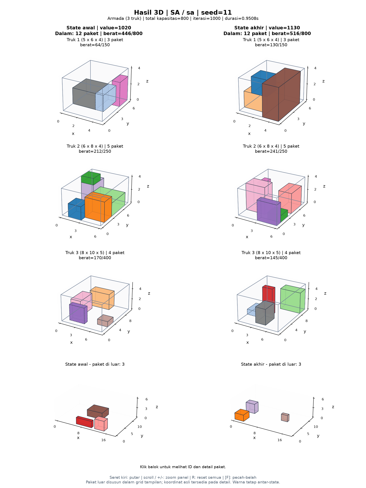

### multi_value / sideways

Seed 11, objective 1285; upper bound tercapai: optimum global terbukti.

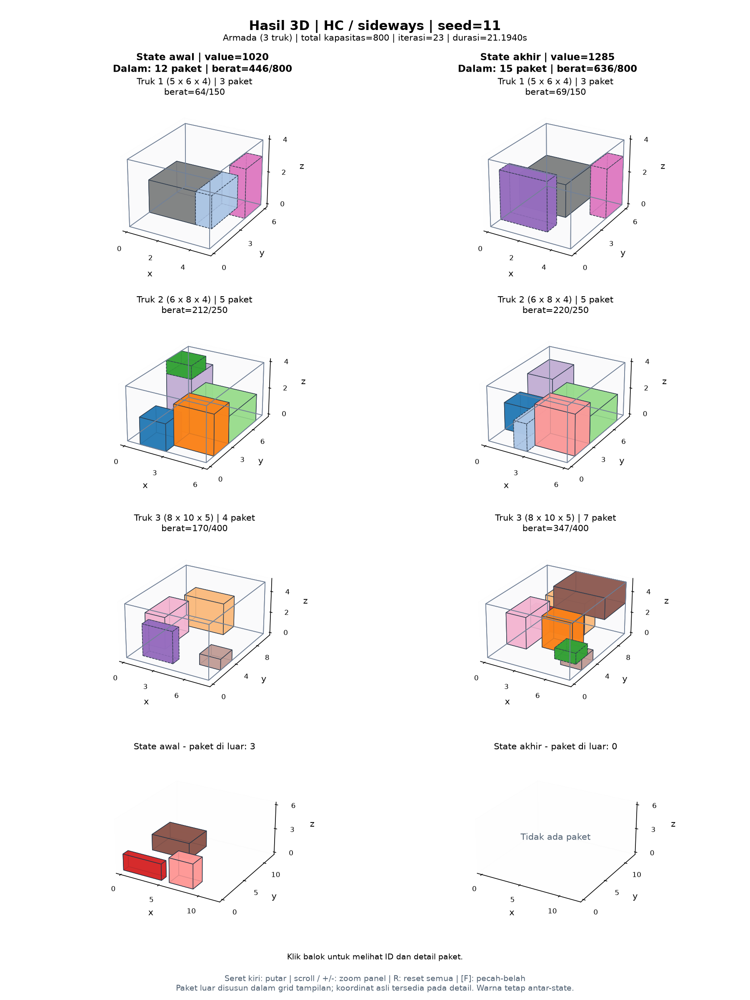

### multi_value / steepest_ascent

Seed 11, objective 1285; upper bound tercapai: optimum global terbukti.

### multi_value / stochastic

Seed 11, objective 1285; upper bound tercapai: optimum global terbukti.

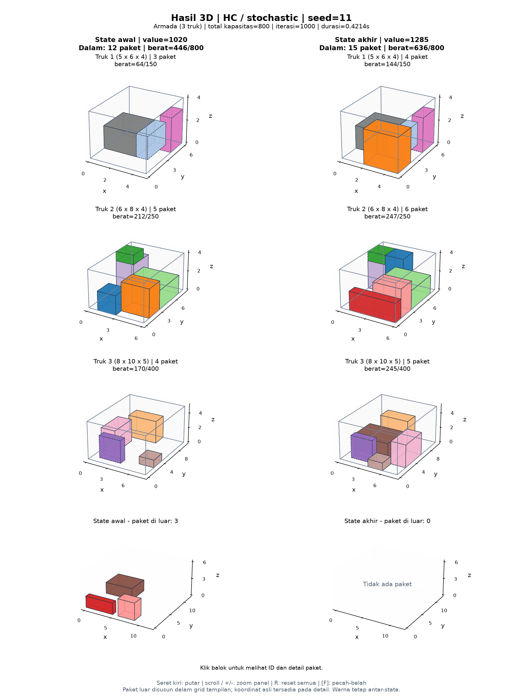

### single_eta / steepest_ascent

Seed 22, objective 362.667; upper bound tercapai: optimum global terbukti.

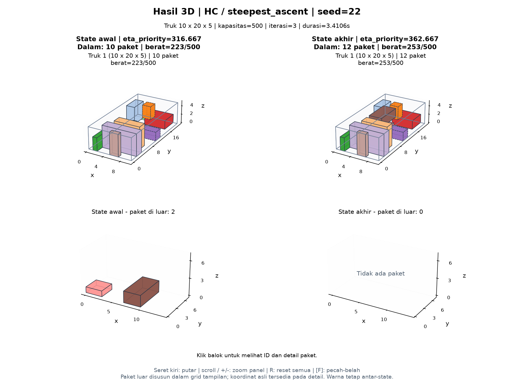

### single_value / ga

Seed 22, objective 1245; upper bound tercapai: optimum global terbukti.

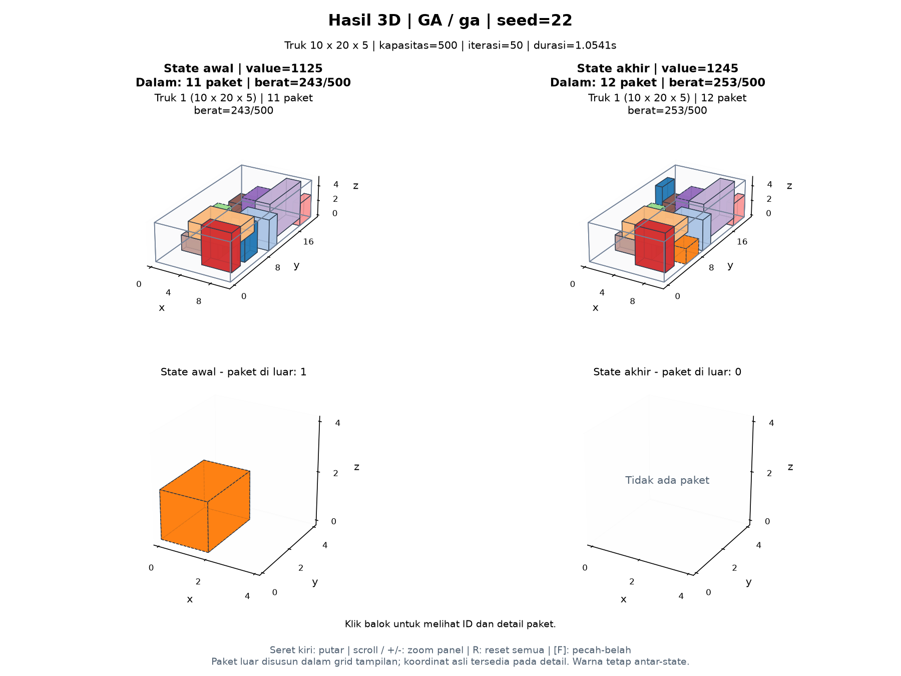

### single_value / random_restart

Seed 11, objective 1245; upper bound tercapai: optimum global terbukti.

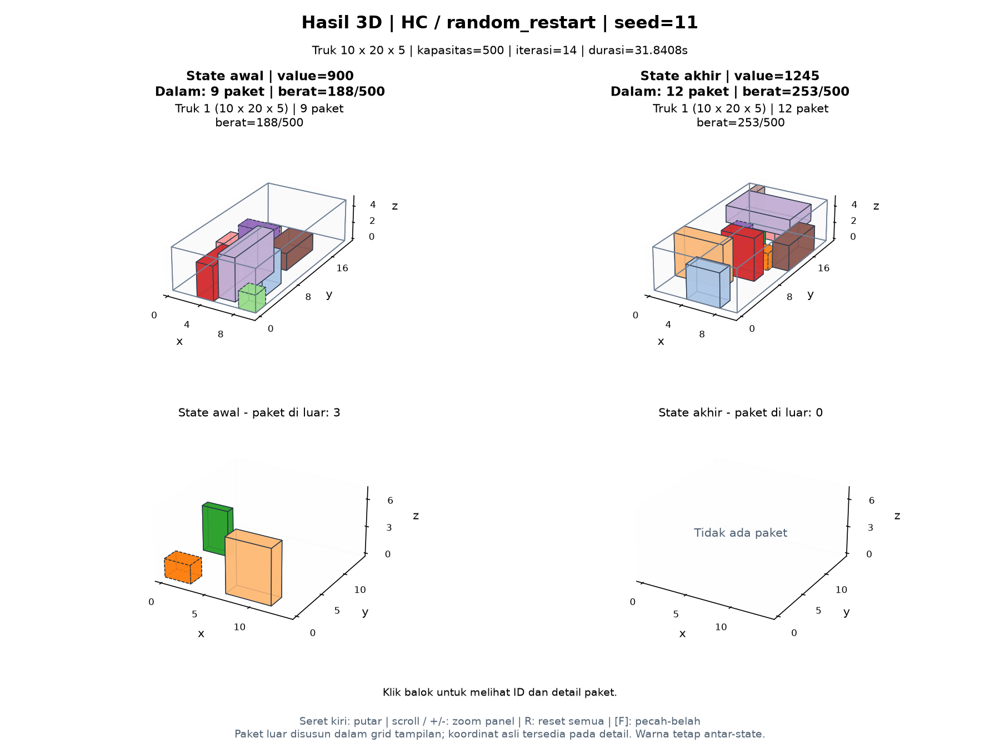

### single_value / sa

Seed 33, objective 1185; 95.18% upper bound; optimum belum dibuktikan.

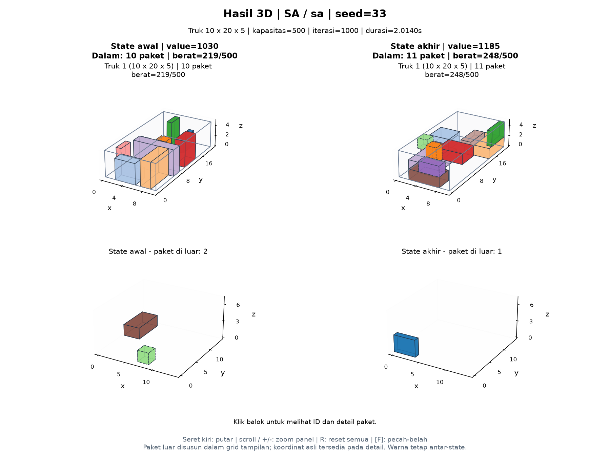

### single_value / sideways

Seed 22, objective 1245; upper bound tercapai: optimum global terbukti.

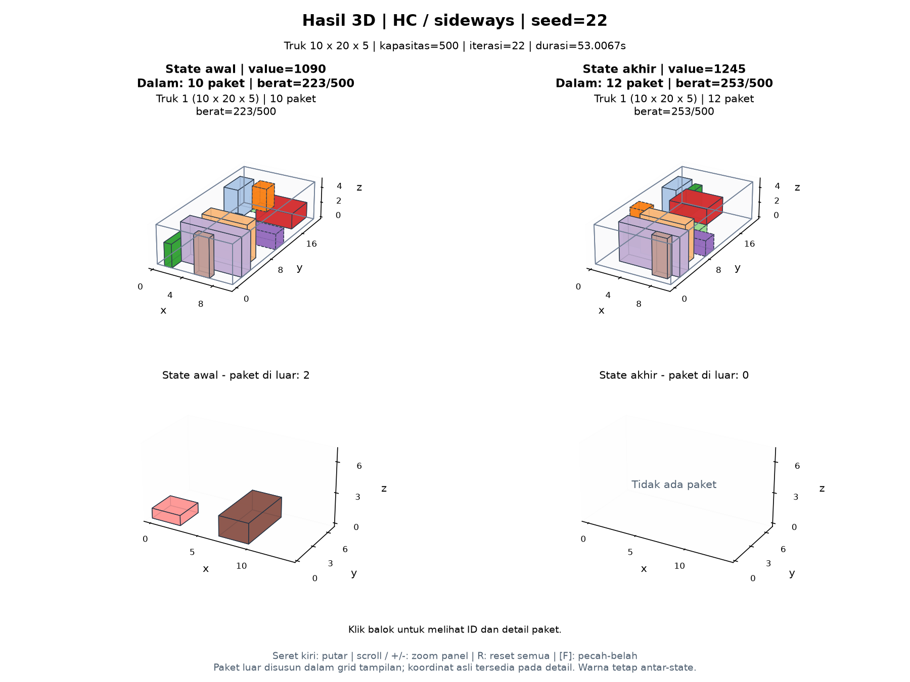

### single_value / steepest_ascent

Seed 22, objective 1245; upper bound tercapai: optimum global terbukti.

### single_value / stochastic

Seed 22, objective 1245; upper bound tercapai: optimum global terbukti.

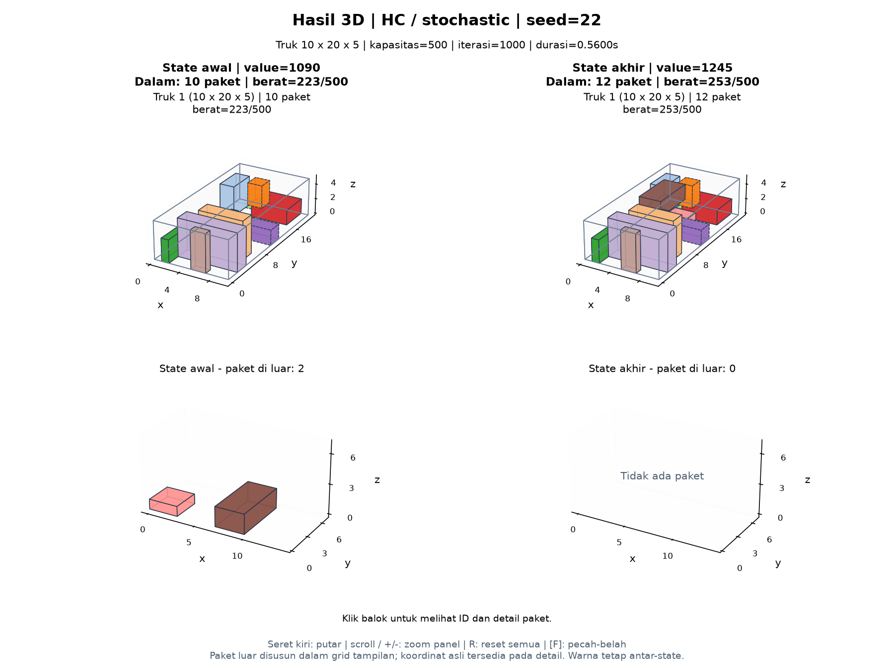
